# sketch

English | [繁體中文](README.zh-TW.md)

**Claude Code answers with pictures instead of paragraphs.**

`sketch` is a Claude Code mod (plugin). It gives Claude 17 drawing tools and one standing instruction: when an answer has a shape, draw the shape. Architecture, flows, roadmaps, user journeys, wireframes and charts appear as cards in the transcript, in your terminal, in your theme's colors.


## Diagrams you can explore

A dense diagram stays readable because you can ask it about one node at a time:

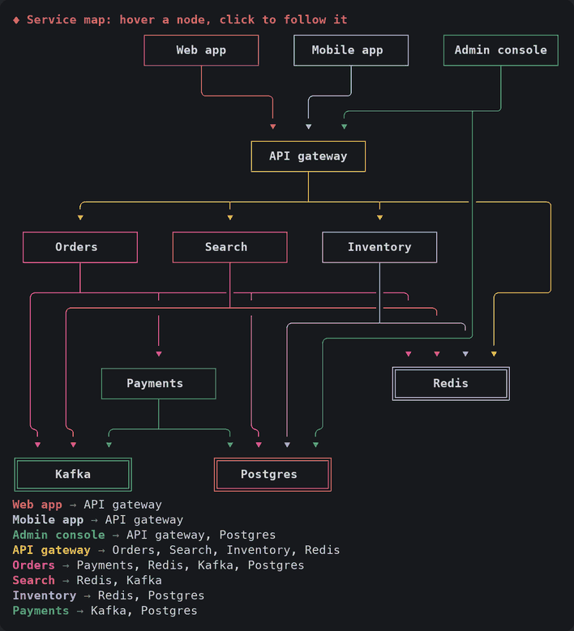

- **Hover** a node: every wire leaving it lights up, end to end.
- **Click** a node's name (anywhere across the middle of its box, or its name in the list under a dense picture): its wires in and out turn thick, sit on top of everything else, and a pulse runs along them from source to target; the rest fades. Click it again to clear it, or click another node to move the focus. Each card keeps its own focus.
- Every node's wires have their own color, and where two wires cross, the later one simply passes over the earlier: no junction marks that could be mistaken for a connection.
- Past a handful of crossings, every connection is also written out under the picture.
- Text too long for its box (a pipeline job, a swimlane step, a node's name or note, a roadmap item) takes a second line where it can; whatever still does not fit shows whole on the line under the card while you hover it.

Hover and click need a terminal that reports the mouse to Claude Code (the fullscreen renderer). The pulse runs for 30 seconds after the last click and then stops, leaving the thick lines; it redraws the focused card a few times a second while it runs.

## Copy or save any card

Every card has two buttons at its top right:

- **⧉ Copy image** puts a picture of the card on the clipboard, ready to paste into Slack, a doc or a slide.
- **⤓ Save PNG** saves the picture under `~/Downloads/sketch/`, as a PNG at twice the size and as an SVG.

Copy saves the same two files too. The picture is drawn whole, title included, in the dark theme's colors: a picture chart is drawn again from its numbers with its ticks, labels and legend, and every other card is laid out cell by cell as the terminal shows it, with its lines drawn as strokes so they join cleanly.

| A picture chart, saved | An architecture card, saved |
| --- | --- |
| 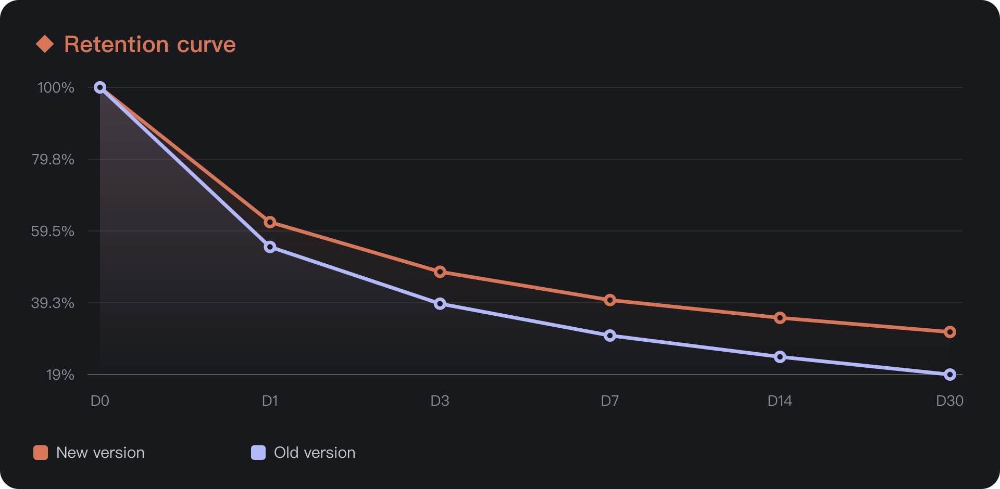 | 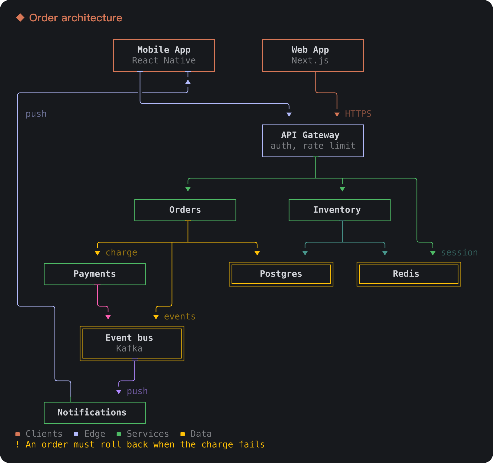 |

Making the PNG uses `rsvg-convert` (librsvg) when it is installed, and on a Mac without it the built-in `sips`; with neither, only the SVG is saved and the message says so (`brew install librsvg` adds the PNG). The clipboard is reached with `osascript` on macOS, and `wl-copy` or `xclip` on Linux; when Copy cannot reach it, the message says why and where the file was saved.

## Install

At the prompt of a Claude Code terminal session:

```
/plugin marketplace add allen-hsu/claude-code-sketch
/plugin install sketch --marketplace allen-hsu/claude-code-sketch
```

Answer `y` to add the marketplace, then pick a scope (user scope loads it in every session).

From a shell:

```
claude plugin install sketch --marketplace allen-hsu/claude-code-sketch
```

In the desktop app, where `/plugin` does not run: click **+** next to the prompt box, then **Plugins**, **Add marketplace** with `allen-hsu/claude-code-sketch`, then **Add plugin**.

Then just ask as usual: "how is this service put together?", "compare these three options", "plan the next quarter". Claude picks the card.

## What you get

| Tool | Draws | Good for |
| --- | --- | --- |
| `layers` | Bands of components, nested zones, side concerns | Tech stacks, platform maps, deployment topologies |
| `diagram` | Nodes and wires, laid out automatically | Architecture wiring, flowcharts, state machines, boundaries (C4), dependencies |
| `schema` | Boxes with fields, and their relations | Data models (ER), class and component diagrams |
| `swimlane` | Steps across lanes of roles or systems | Processes with handovers |
| `pipeline` | Stages left to right, each a column of jobs | CI/CD, ETL, data flows |
| `gitgraph` | Branches, commits, merges and tags | Branching strategy, release flow |
| `sequence` | Actors and the messages between them | Request flows, protocols, handoffs |
| `tree` | An outline or a mind map | Goal breakdowns, sitemaps, taxonomies |
| `timeline` | Bars over periods, milestones | Roadmaps, gantt schedules, study plans |
| `board` | Columns of cards | Kanban, now / next / later |
| `quadrant` | Points on two axes, or four lists | Prioritisation, positioning, SWOT |
| `journey` | Stages, a mood line, rows of notes | User journeys, service blueprints |
| `wireframe` | A low-fidelity screen | Page and app layouts |
| `metrics` | Number tiles with a trend | KPIs, experiment results |
| `chart` | Bar, column, stacked, line, scatter, heatmap, histogram, funnel, share | Any numbers you already have |
| `cards` | Titled cards with tags and quotes | Personas, research findings, principles |
| `compare` | Options side by side, then a pick dialog | Decisions between two to four options |

The cards below are drawn from the made-up inputs in [`preview/samples.en.ts`](preview/samples.en.ts). Labels can be in any language; Chinese, Japanese and Korean text is measured correctly (see the [繁體中文 README](README.zh-TW.md) for the same cards in Chinese).

## Architecture and structure

`layers` shows what a system is made of. `diagram` shows how it connects: each node's wires have their own color, an edge that loops back is drawn with an upward arrow, and a node's shape says what it is (decision, store, external system). `numbers: true` numbers the nodes and marks each arrow with where it comes from.

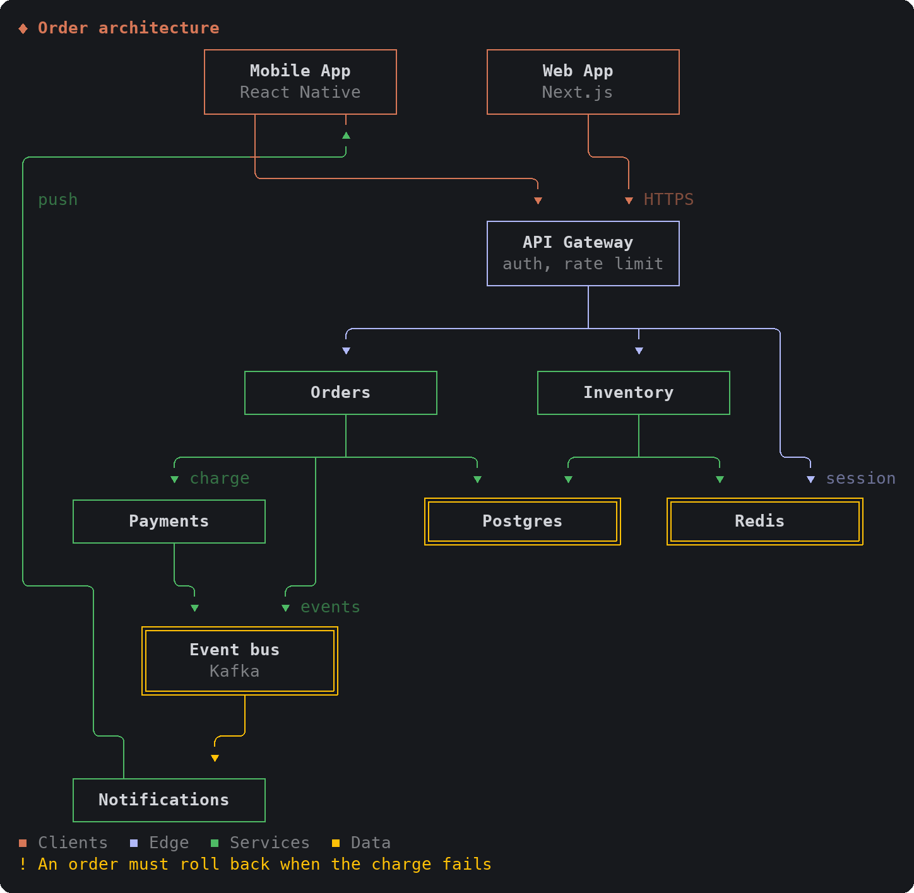

| Flowchart | Dependencies |
| --- | --- |
|  |  |

When dependencies are too dense for wires, `layout: "matrix"` draws who uses whom as a grid, with counts:

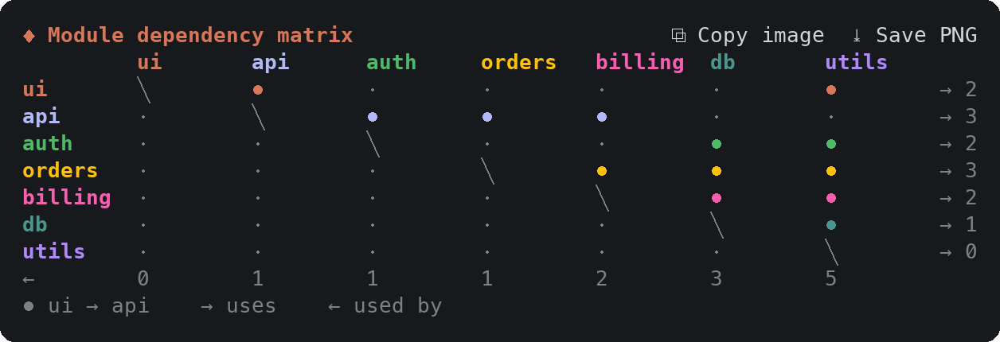

With `layout: "zones"`, each group becomes a framed band: subsystems, network boundaries, a C4 container view. The `person` shape marks a user or a role.

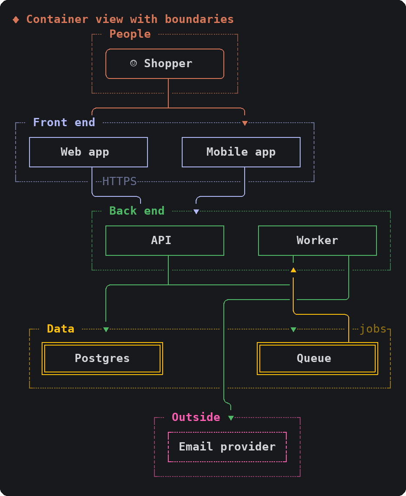

An edge from a node to itself is drawn as a loop inside the node, so a state machine is a diagram too:

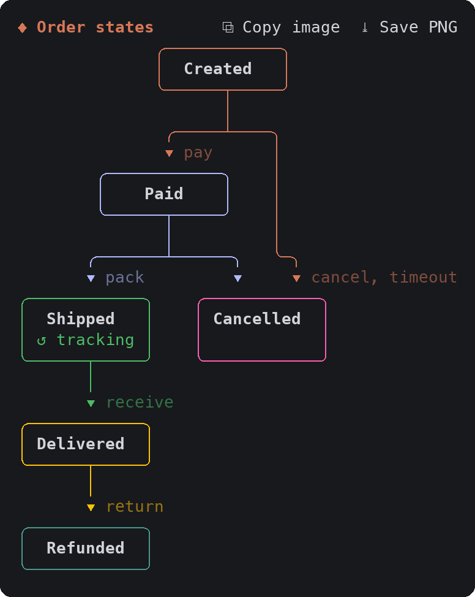

Zones in `layers` can hold zones of their own, which covers deployment topologies (region, availability zone, subnet):


`schema` draws tables or classes with their fields, and the relations between them:

| Data model (ER) | Classes |
| --- | --- |
|  | 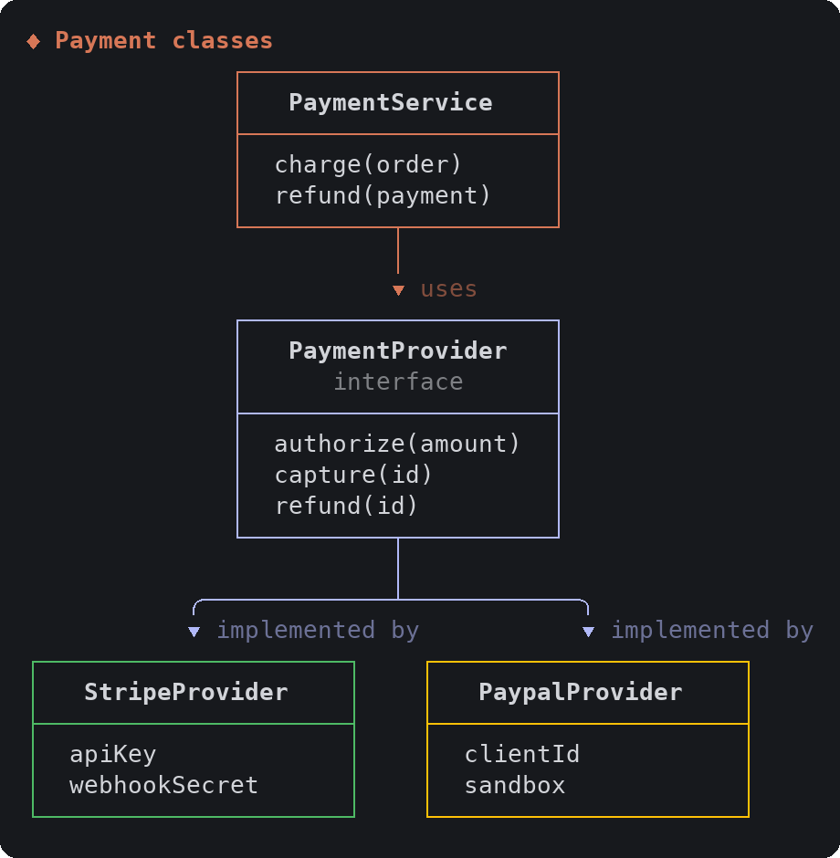 |

`swimlane` puts each step of a process in the lane of whoever does it, `pipeline` lays stages out left to right, and `gitgraph` shows branches over time:


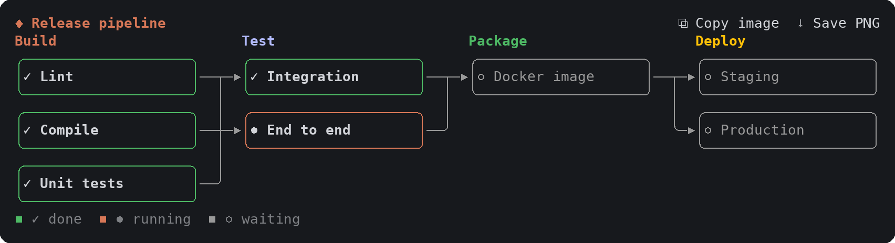

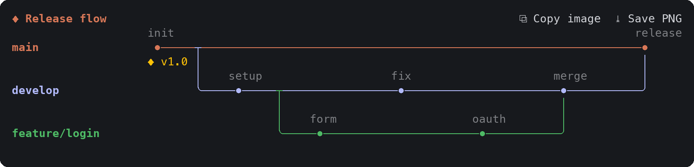

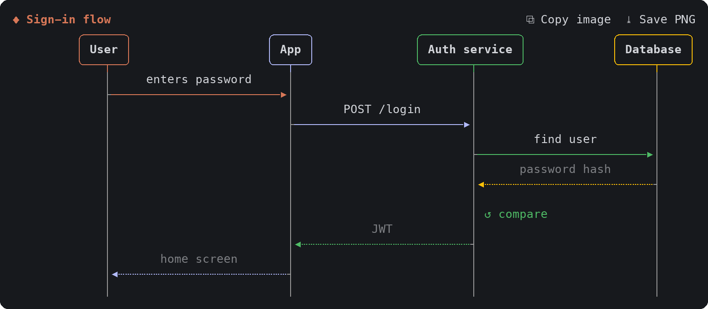

| Outline | Mind map |
| --- | --- |
|  | 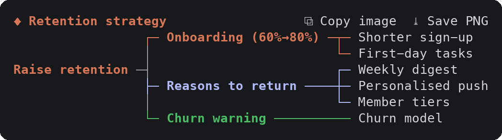 |

## Product and planning


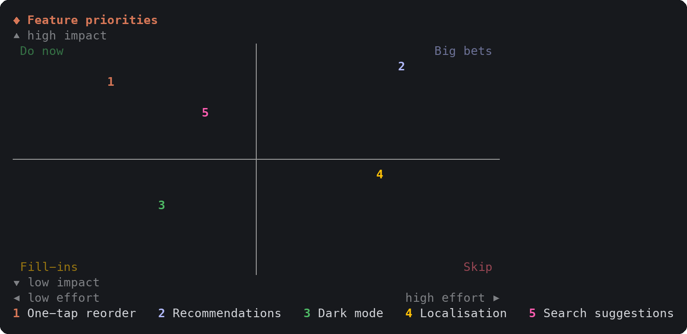

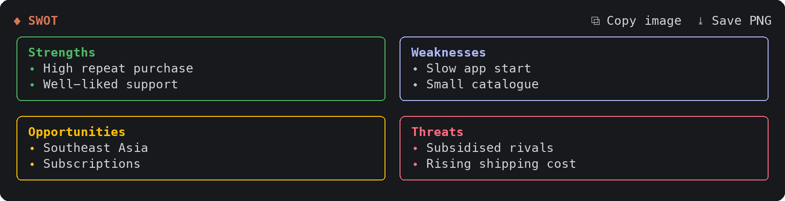

`compare` draws the options, then opens a dialog under the cards so you pick with the arrow keys; Claude carries on with your choice.

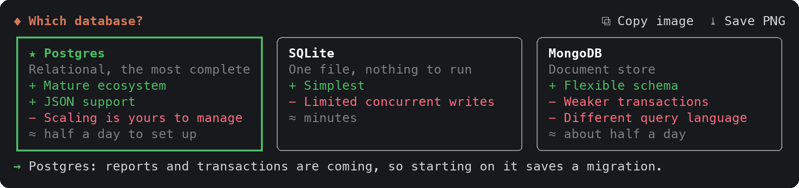

## Design and research

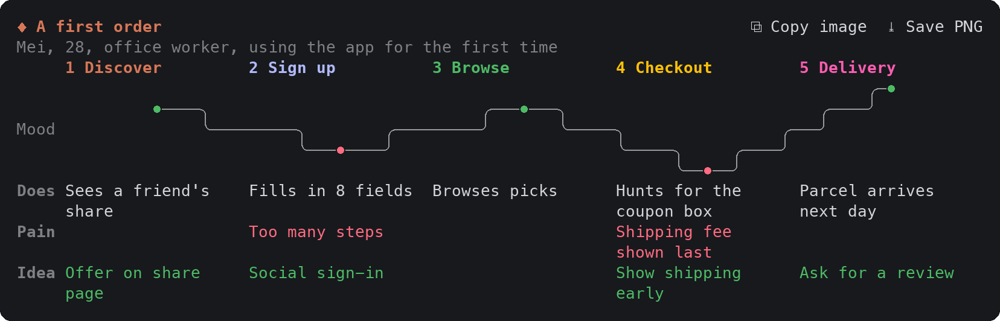


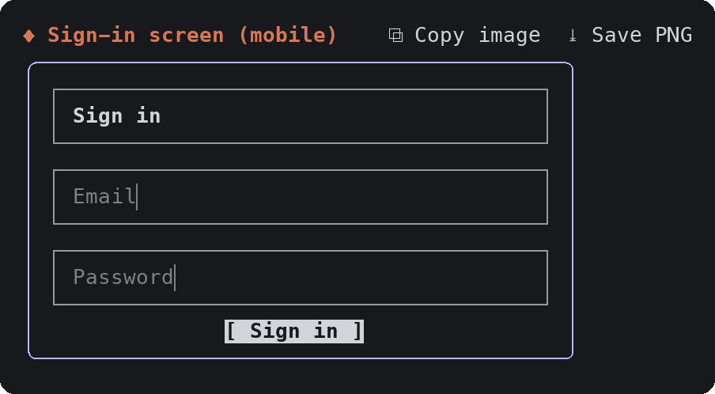


## Numbers

Charts, metric tiles, timelines and journeys draw themselves in while Claude's call runs:

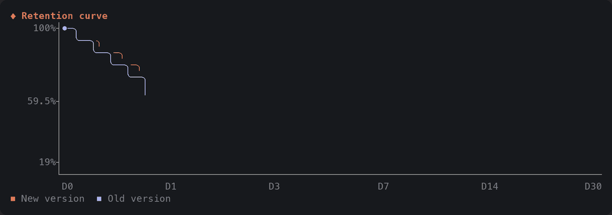

With `style: "image"`, a line, scatter, column or histogram chart draws its plot as a real picture, with smooth lines, translucent areas and rounded bars, in terminals that show images (kitty, Ghostty, iTerm2; elsewhere a line of alt text stands in). Ticks and the legend stay text beside it, since a picture in the terminal has no font. The saved picture above is one of these.

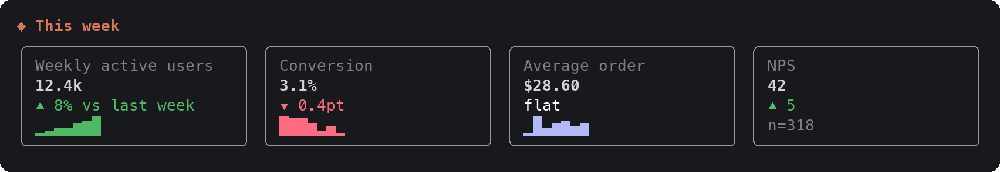

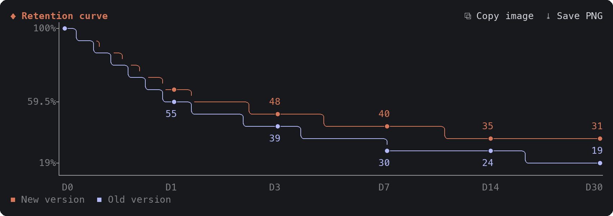

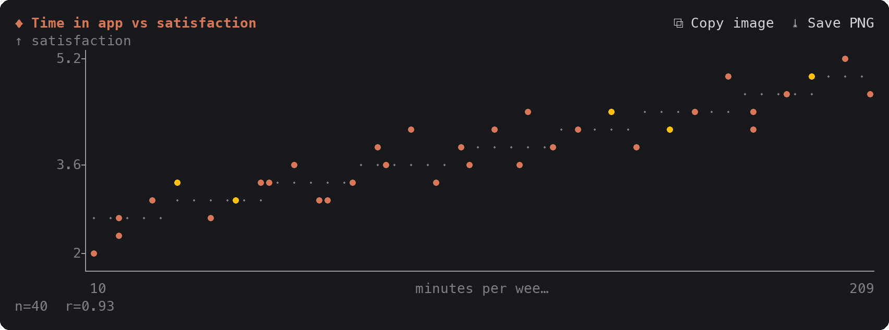

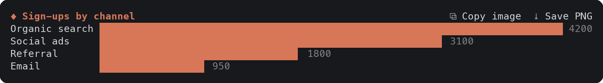

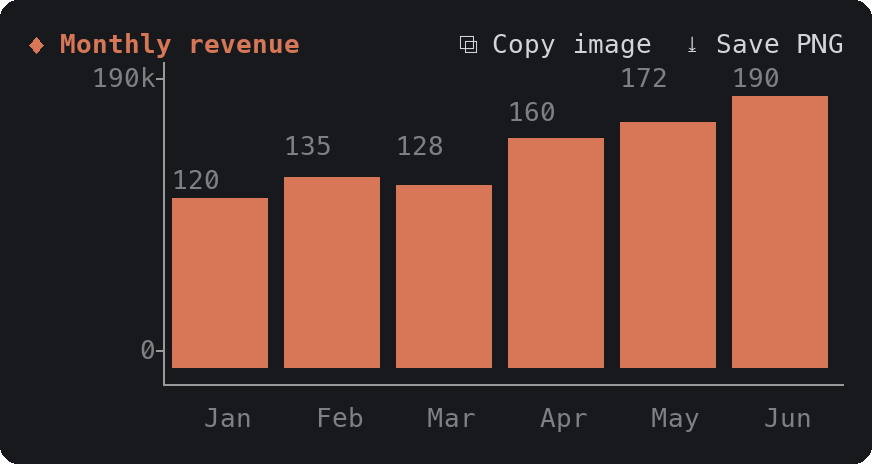

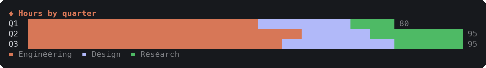

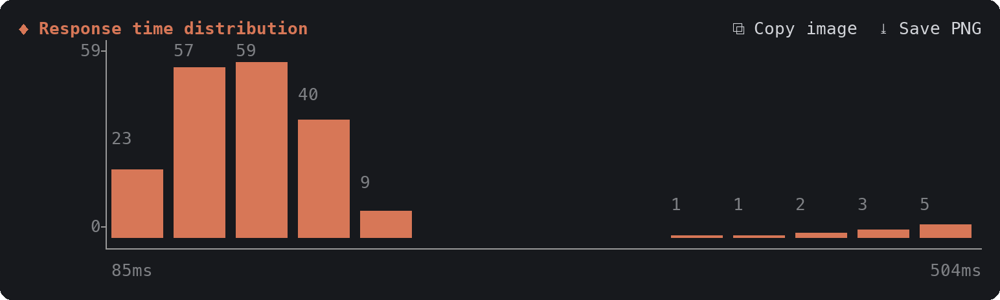

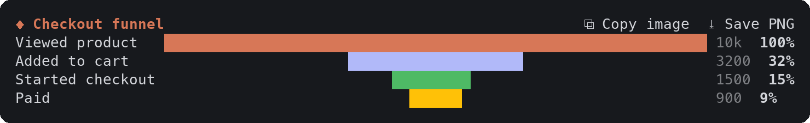


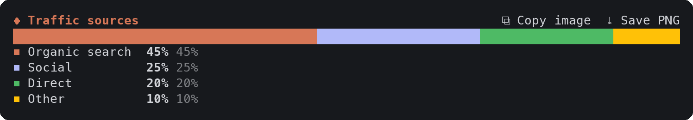

## How it works

The whole mod is one hooks module, [`hooks/register.tsx`](hooks/register.tsx):

- At session start it registers the 17 tools. Each takes plain structured input (nodes and edges, periods and items, labels and series).
- A `ui.render` hook replaces each tool call's row in the transcript with the card, drawn from the call's own input. Hover groups light a node's wires with no code running; node names are buttons, and the one piece of state the mod keeps is which node each diagram card has focused (declared in [`types/index.d.ts`](types/index.d.ts)), plus the tick the pulse steps on.
- A `prompt.compose` hook adds one short section to the system prompt telling Claude when to reach for which card and to keep the text around it brief.
- Charts, metrics, timelines and journeys draw themselves in over about a second while the call runs.
- Press `ctrl+o` to see the raw tool call behind a card.
- Copy and Save write `~/Downloads/sketch/` and run the converter and clipboard commands above; nothing else on your machine is written or run.

Things to know:

- The tool definitions and the prompt section ride on every request in a session where the mod is loaded: roughly 5 thousand tokens (an estimate, not a measurement).
- Cards are sized to the terminal width when they are drawn. Below about 60 columns the wider cards get cramped.
- Wide characters (Chinese, Japanese, Korean) are measured as two cells. A terminal that draws ambiguous-width symbols such as `●` two cells wide will misalign some cards.
- Built and tried on Claude Code 2.1.325 in a terminal. The cards use only `Box` and `Text`, which every surface has, but the desktop and mobile surfaces are untested.

## About the images

The images in this README are not window screenshots. They are produced by the scripts in [`preview/`](preview): `render.ts` runs the mod's real hooks against a stand-in engine with a small flex layout of its own, and `paint.py` paints the resulting cells with the default dark theme's colors. `frames.ts` renders the animations frame by frame from the same hooks; in them, the hovered state is drawn as the terminal draws it, without a pointer. Layout in your terminal comes from Claude Code's own engine and your theme, so spacing and colors can differ slightly.

To regenerate them (macOS, needs [Bun](https://bun.sh) and Python with Pillow; use `samples.zh-TW.ts` and `docs/images/zh-TW` for the Chinese set):

```
cd preview
bun --jsx-factory=h --jsx-fragment=Fragment --jsx-runtime=classic render.ts ../hooks/register.tsx 110 cards.json ./samples.en.ts
python3 paint.py cards.json ../docs/images/en
bun --jsx-factory=h --jsx-fragment=Fragment --jsx-runtime=classic frames.ts ../hooks/register.tsx 110 ./samples.en.ts anim
SKETCH_GIF_SCALE=0.55 python3 paint.py anim-interaction.frames.json ../docs/images/en/interaction.gif
python3 paint.py anim-entrance.frames.json ../docs/images/en/entrance.gif
bun --jsx-factory=h --jsx-fragment=Fragment --jsx-runtime=classic exports.ts ../hooks/register.tsx ./samples.en.ts ../docs/images/en
```

## Develop

```
claude --plugin-dir .        # run a session with the mod loaded from this folder
claude plugin validate .     # check the manifest and the hooks module
```

Edits to `hooks/register.tsx` hot-reload in a session started with `--plugin-dir`.

## License

MIT
