# sketch

**Claude Code answers with pictures instead of paragraphs.**

`sketch` is a Claude Code mod (plugin). It gives Claude 13 drawing tools and one standing instruction: when an answer has a shape, draw the shape. Architecture, flows, roadmaps, user journeys, wireframes and charts appear as cards in the transcript, in your terminal, in your theme's colors.

讓 Claude Code 用圖回答，不再是一大段文字。裝上後 Claude 多了 13 種繪圖工具，遇到架構、流程、路線圖、使用者旅程、線框圖、數據，會直接在終端機畫成卡片。中日韓文字寬度已處理，可直接用中文。

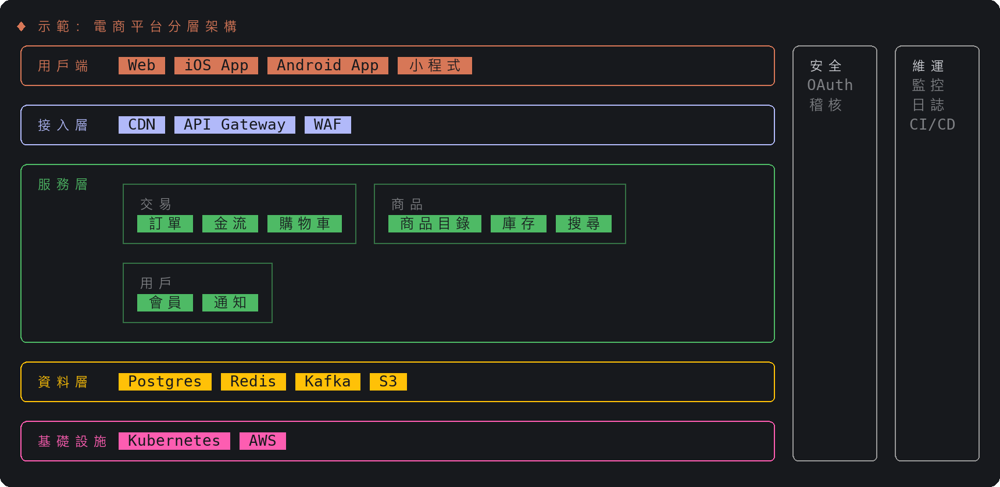

## Install

At the prompt of a Claude Code terminal session:

```
/plugin install sketch --marketplace allen-hsu/claude-code-sketch
```

Answer `y` to add the marketplace, then pick a scope (user scope loads it in every session).

From a shell:

```
claude plugin install sketch --marketplace allen-hsu/claude-code-sketch
```

In the desktop app, where `/plugin` does not run: click **+** next to the prompt box, then **Plugins**, **Add marketplace** with `allen-hsu/claude-code-sketch`, then **Add plugin**.

Then just ask as usual: "how is this service put together?", "compare these three options", "plan the next quarter". Claude picks the card.

## What you get

| Tool | Draws | Good for |
| --- | --- | --- |
| `layers` | Bands of components, zones, side concerns | Tech stacks, platform maps, system overviews |
| `diagram` | Nodes and wires, laid out automatically | Architecture wiring, flowcharts, dependencies |
| `sequence` | Actors and the messages between them | Request flows, protocols, handoffs |
| `tree` | An outline or a mind map | Goal breakdowns, sitemaps, taxonomies |
| `timeline` | Bars over periods, milestones | Roadmaps, gantt schedules, study plans |
| `board` | Columns of cards | Kanban, now / next / later |
| `quadrant` | Points on two axes, or four lists | Prioritisation, positioning, SWOT |
| `journey` | Stages, a mood line, rows of notes | User journeys, service blueprints |
| `wireframe` | A low-fidelity screen | Page and app layouts |
| `metrics` | Number tiles with a trend | KPIs, experiment results |
| `chart` | Bar, column, stacked, line, scatter, heatmap, histogram, funnel, share | Any numbers you already have |
| `cards` | Titled cards with tags and quotes | Personas, research findings, principles |
| `compare` | Options side by side, then a pick dialog | Decisions between two to four options |

The cards below are drawn from the made-up inputs in [`preview/samples.ts`](preview/samples.ts).

## Architecture and structure

`layers` shows what a system is made of. `diagram` shows how it connects: wires leaving a node travel together in that node's color, loops are drawn with an upward arrow, and a node's shape says what it is (decision, store, external system).

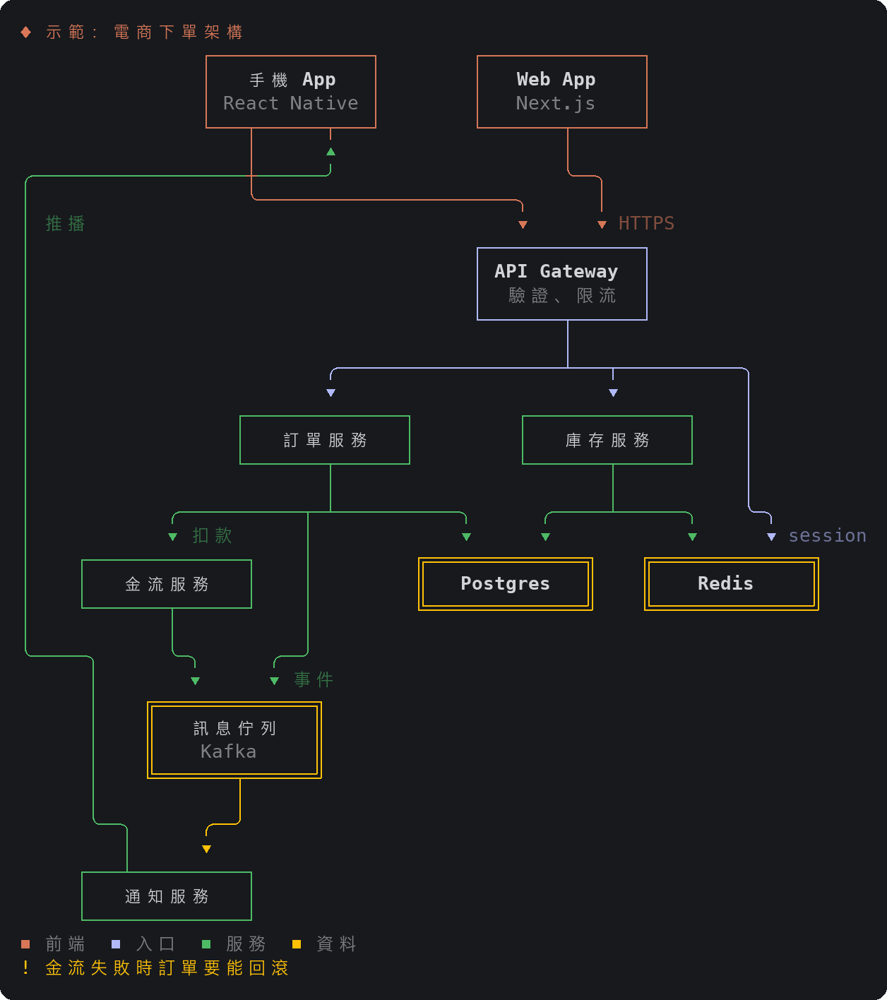

| Flowchart | Dependencies |
| --- | --- |
| 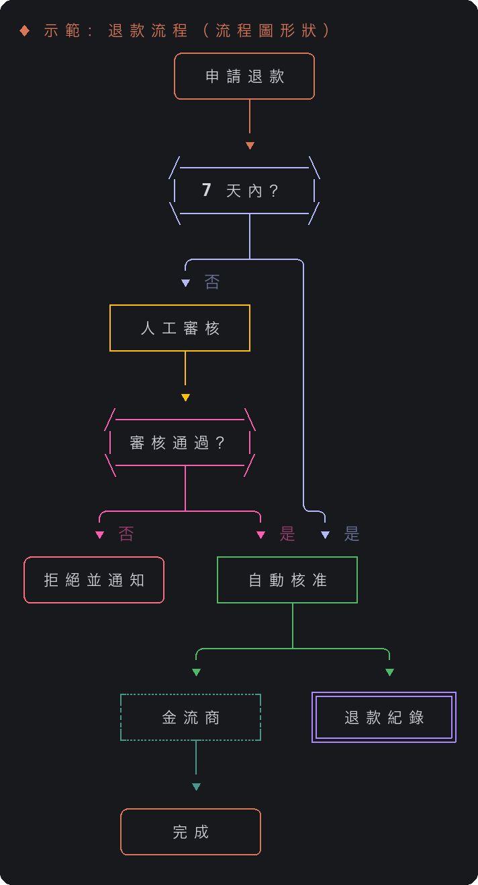 | 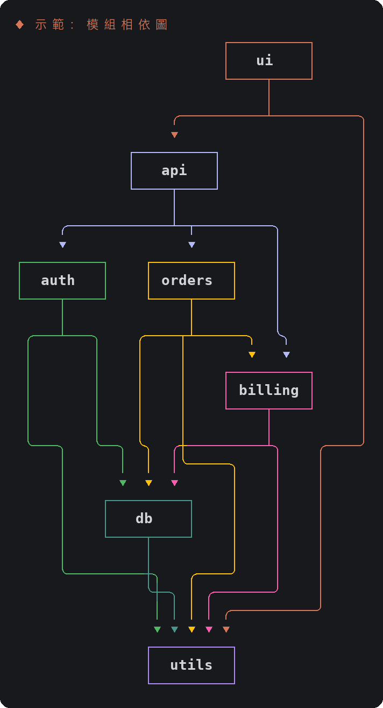 |

When dependencies are too dense for wires, `layout: "matrix"` draws who uses whom as a grid, with counts:

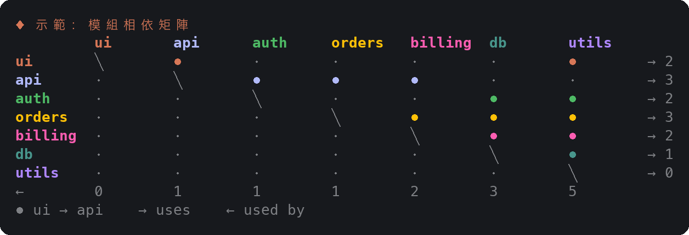

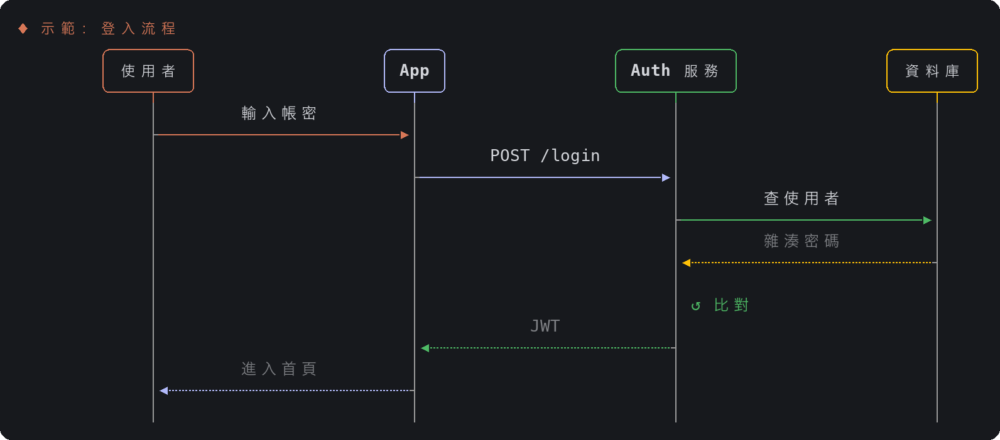

| Outline | Mind map |
| --- | --- |
| 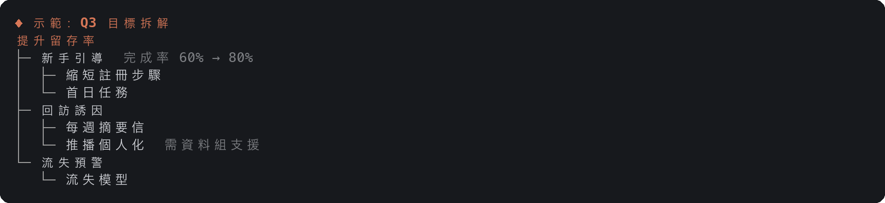 | 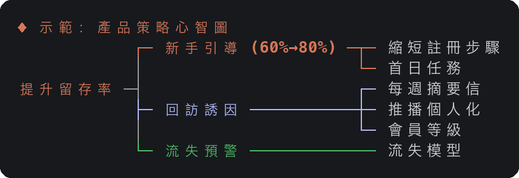 |

## Product and planning

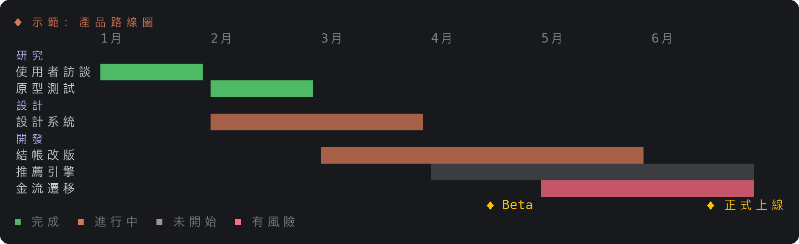

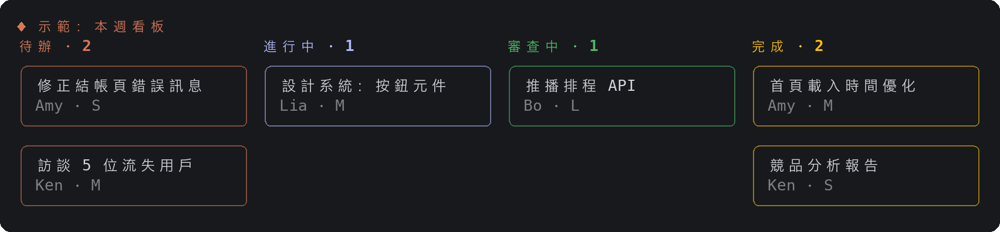

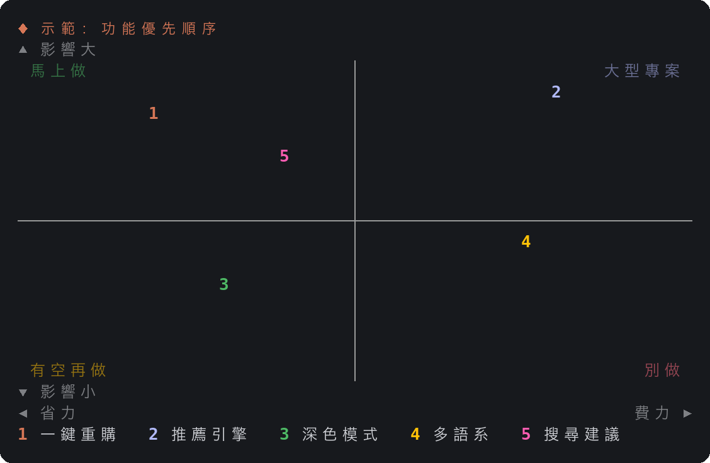

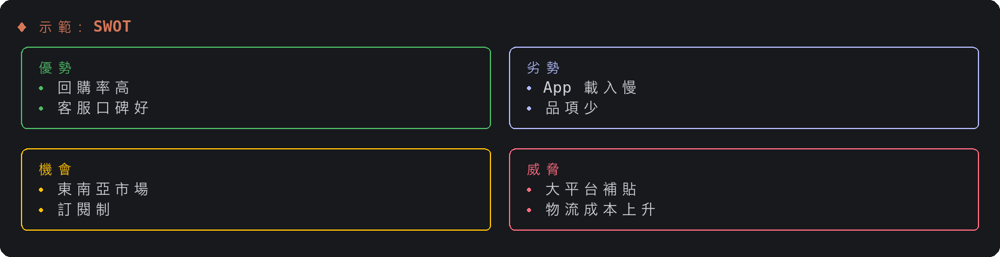

`compare` draws the options, then opens a dialog under the cards so you pick with the arrow keys; Claude carries on with your choice.

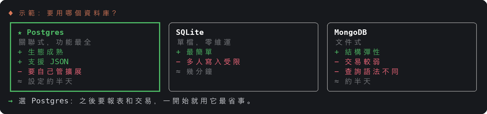

## Design and research

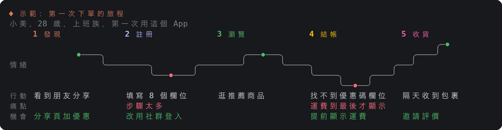

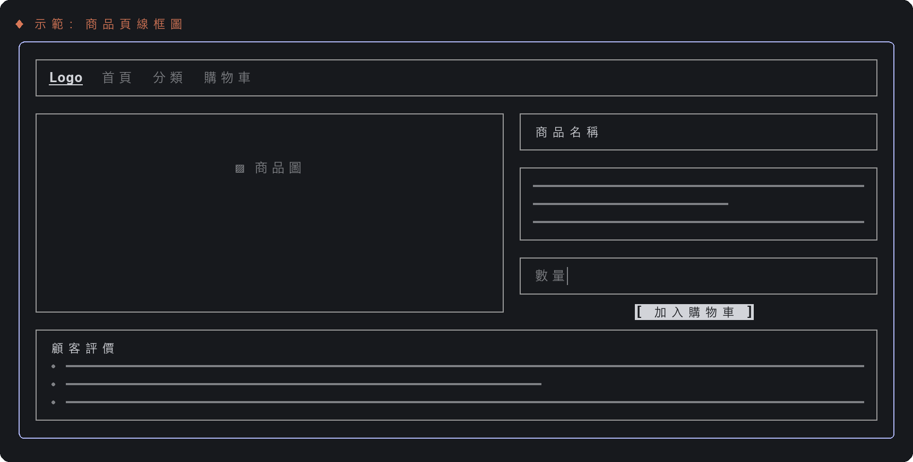

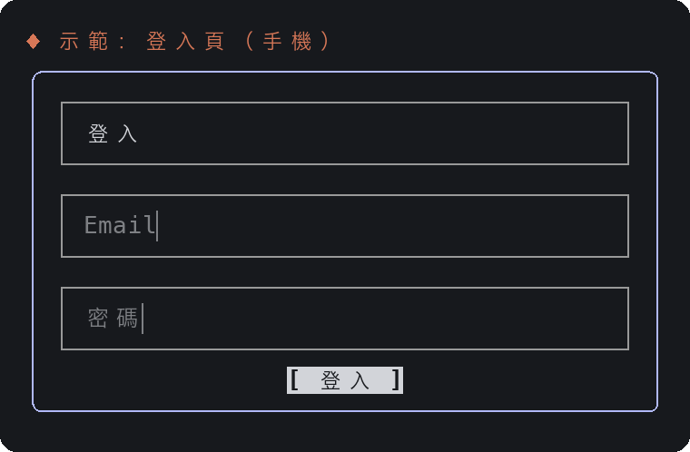

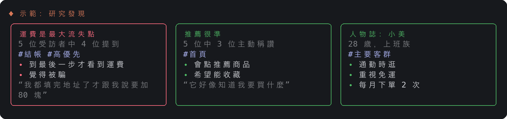

## Numbers

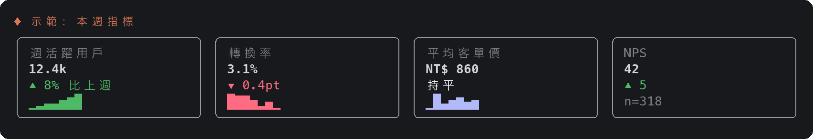

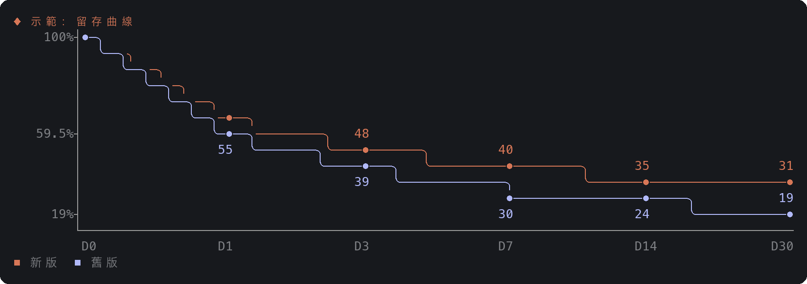

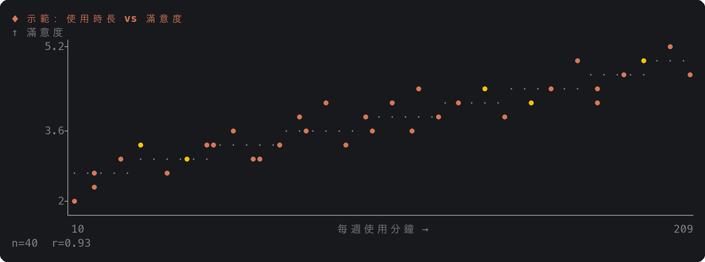

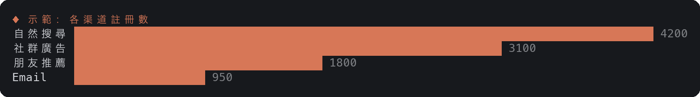

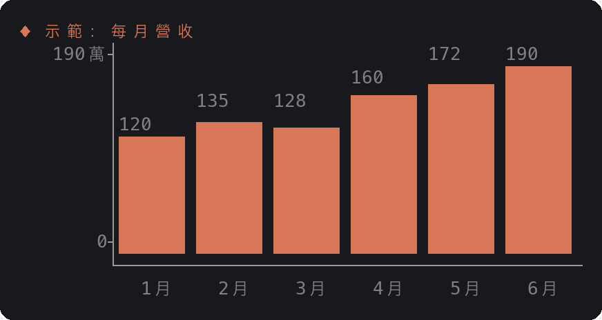

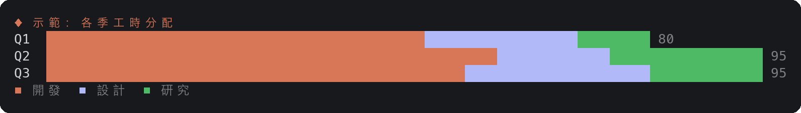

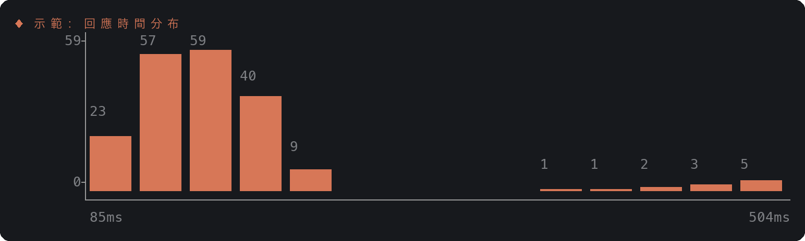

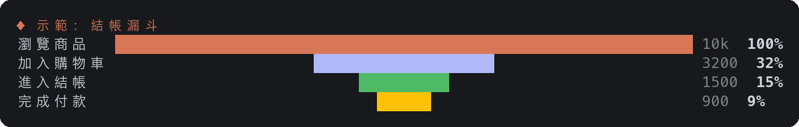

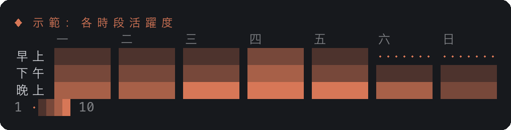

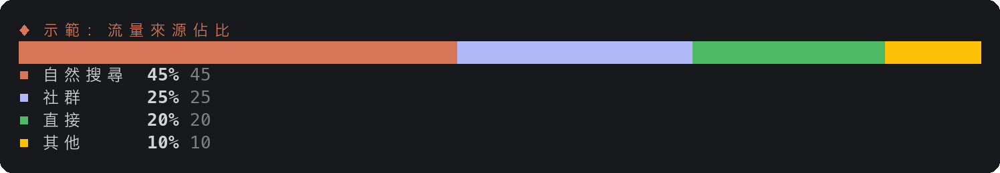

## How it works

The whole mod is one hooks module, [`hooks/register.tsx`](hooks/register.tsx):

- At session start it registers the 13 tools. Each takes plain structured input (nodes and edges, periods and items, labels and series).
- A `ui.render` hook replaces each tool call's row in the transcript with the card, drawn from the call's own input. The mod keeps no state.
- A `prompt.compose` hook adds one short section to the system prompt telling Claude when to reach for which card and to keep the text around it brief.
- Charts, metrics, timelines and journeys play a half-second entrance while the call runs.
- Press `ctrl+o` to see the raw tool call behind a card.

Things to know:

- The tool definitions and the prompt section ride on every request in a session where the mod is loaded: roughly 3 to 4 thousand tokens (an estimate, not a measurement).
- Cards are sized to the terminal width when they are drawn. Below about 60 columns the wider cards get cramped.
- Wide characters (Chinese, Japanese, Korean) are measured as two cells. A terminal that draws ambiguous-width symbols such as `●` two cells wide will misalign some cards.
- Built and tried on Claude Code 2.1.325 in a terminal. The cards use only `Box` and `Text`, which every surface has, but the desktop and mobile surfaces are untested.

## About the images

The images in this README are not window screenshots. They are produced by the scripts in [`preview/`](preview): `render.ts` runs the mod's real hooks against a stand-in engine with a small flex layout of its own, and `paint.py` paints the resulting cells with the default dark theme's colors. Layout in your terminal comes from Claude Code's own engine and your theme, so spacing and colors can differ slightly.

To regenerate them (macOS, needs [Bun](https://bun.sh) and Python with Pillow):

```
cd preview
bun --jsx-factory=h --jsx-fragment=Fragment --jsx-runtime=classic render.ts ../hooks/register.tsx 110 cards.json
python3 paint.py cards.json ../docs/images
```

## Develop

```
claude --plugin-dir .        # run a session with the mod loaded from this folder
claude plugin validate .     # check the manifest and the hooks module
```

Edits to `hooks/register.tsx` hot-reload in a session started with `--plugin-dir`.

## License

MIT
