# sketch

[English](README.md) | 繁體中文

**讓 Claude Code 用圖回答，不再是一大段文字。**

`sketch` 是一個 Claude Code mod（plugin）。它給 Claude 17 種繪圖工具，外加一條固定的指示：答案有形狀的時候，就把形狀畫出來。架構、流程、路線圖、使用者旅程、線框圖、圖表，都會以卡片的形式直接出現在終端機的對話裡，顏色跟著你的主題走。

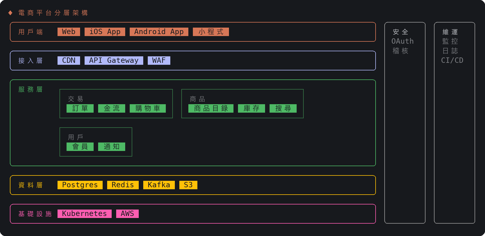

## 可以互動的架構圖

線再多的圖也看得懂，因為你可以一次只看一個節點：

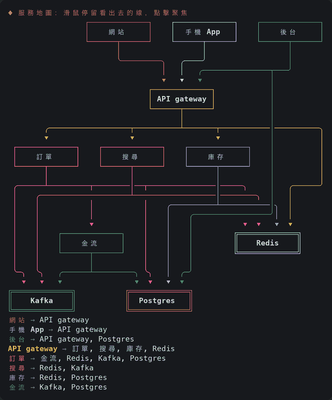

- **滑鼠停留**在節點上：從它出去的每條線都會從頭到尾亮起來。
- **點擊**節點名稱（框中間那一整排都可以點，線很多時圖下清單裡的名稱也可以）：它進出的線變粗、壓在最上層，還會有一段亮光從起點流向終點；其他線變淡。再點一次取消，點別的節點就切換過去。每張卡片各自記住聚焦哪個節點。
- 每個節點的線各有自己的顏色。兩條線交叉時，後畫的直接疊在上面，不畫接點，所以不會誤以為兩條線是相連的。
- 交叉一多，圖下也會用文字列出每一條連線。
- 方塊放不下的文字（管線圖的工作、泳道圖的步驟、節點名稱或說明、路線圖項目）會先換成兩行；還是放不下的，滑鼠停在上面時，卡片最下面那一行會顯示完整內容。

滑鼠停留和點擊需要終端機把滑鼠位置回報給 Claude Code（全螢幕介面）。流動效果在最後一次點擊 30 秒後停止，粗線保留；流動期間每秒會重畫那張卡片幾次。

## 複製或儲存任何卡片

每張卡片的右上角都有兩個按鈕：

- **⧉ Copy image**：把卡片的圖片放進剪貼簿，可以直接貼到 Slack、文件或簡報。
- **⤓ Save PNG**：把圖片存到 `~/Downloads/sketch/`，一份兩倍大小的 PNG，一份 SVG。

按 Copy 也會同時存這兩個檔案。存下來的是完整的一張圖，包括標題，使用深色主題的配色：圖片版圖表會用資料重畫，刻度、標籤和圖例都在圖裡；其他卡片則照終端機的樣子一格一格排出來，線條畫成真正的線段，轉角和接點都是連起來的。

| 存下來的圖片版圖表 | 存下來的架構圖 |
| --- | --- |
| 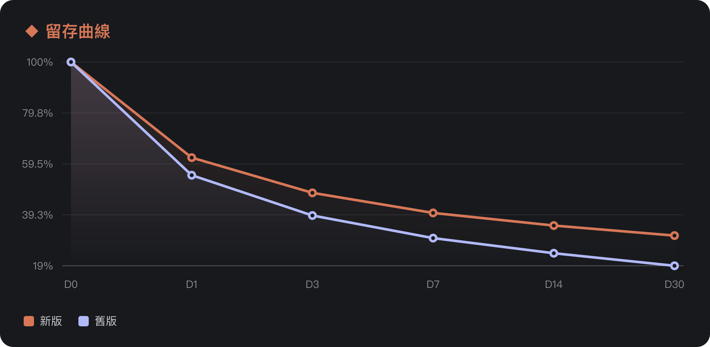 | 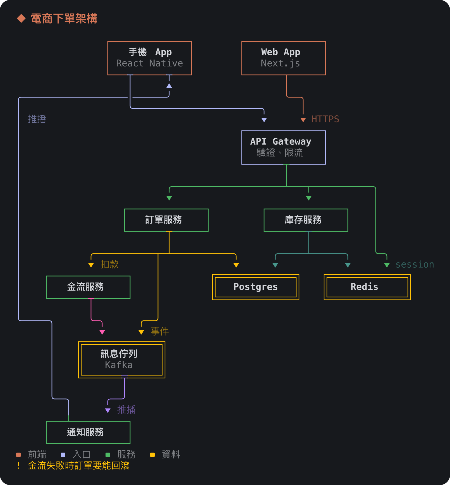 |

產生 PNG 時，有安裝 `rsvg-convert`（librsvg）就用它；沒有的 Mac 改用內建的 `sips`；兩者都不能用時只會存 SVG，提示訊息會說明（執行 `brew install librsvg` 之後就能產生 PNG）。放進剪貼簿在 macOS 用 `osascript`，在 Linux 用 `wl-copy` 或 `xclip`；Copy 沒辦法放進剪貼簿時，提示訊息會說明原因和檔案存在哪裡。

## 安裝

在 Claude Code 終端機的提示列輸入：

```
/plugin marketplace add allen-hsu/claude-code-sketch
/plugin install sketch --marketplace allen-hsu/claude-code-sketch
```

出現詢問時按 `y` 加入 marketplace，再選擇範圍（選 user 範圍，之後每個 session 都會載入）。

從 shell 安裝：

```
claude plugin install sketch --marketplace allen-hsu/claude-code-sketch
```

桌面版無法執行 `/plugin`：點提示框旁的 **+**，選 **Plugins**，用 `allen-hsu/claude-code-sketch` 執行 **Add marketplace**，再 **Add plugin**。

裝好後照平常問就好：「這個服務是怎麼組成的？」「比較這三個方案」「規劃下一季」。要畫哪種卡片由 Claude 決定。

## 有哪些卡片

| 工具 | 畫什麼 | 適合用在 |
| --- | --- | --- |
| `layers` | 一層一層的元件、可巢狀的分區、橫跨各層的面向 | 技術堆疊、平台地圖、部署拓撲 |
| `diagram` | 節點與連線，自動排版 | 架構連線、流程圖、狀態機、邊界（C4）、相依關係 |
| `schema` | 帶欄位的方塊與彼此的關係 | 資料模型（ER）、類別圖與元件圖 |
| `swimlane` | 依角色或系統分道的步驟 | 有交接的流程 |
| `pipeline` | 由左到右的階段，每個階段一欄工作 | CI/CD、ETL、資料流 |
| `gitgraph` | 分支、提交、合併與標籤 | 分支策略、發版流程 |
| `sequence` | 參與者與彼此之間的訊息 | 請求流程、協定、交接 |
| `tree` | 大綱或心智圖 | 目標拆解、網站地圖、分類 |
| `timeline` | 跨時段的長條與里程碑 | 路線圖、甘特圖、讀書計畫 |
| `board` | 一欄一欄的卡片 | 看板、現在／接下來／以後 |
| `quadrant` | 兩個軸上的點，或四個清單 | 優先順序、定位、SWOT |
| `journey` | 階段、情緒曲線、多列筆記 | 使用者旅程、服務藍圖 |
| `wireframe` | 低擬真的畫面草圖 | 網頁與 App 版面 |
| `metrics` | 數字方塊與走勢 | KPI、實驗結果 |
| `chart` | 長條、直條、堆疊、折線、散佈、熱力圖、直方圖、漏斗、佔比 | 任何你手上已有的數字 |
| `cards` | 帶標籤與引言的資訊卡 | 人物誌、研究發現、設計原則 |
| `compare` | 並排的選項，加上選擇對話框 | 在二到四個方案之間做決定 |

以下卡片都是用 [`preview/samples.zh-TW.ts`](preview/samples.zh-TW.ts) 裡的虛構資料畫的。

## 架構與結構

`layers` 呈現系統由什麼組成。`diagram` 呈現它們怎麼連接：每個節點的線各有自己的顏色；往回連的線以向上的箭頭表示；節點的形狀代表它的角色（判斷、儲存、外部系統）。加上 `numbers: true` 會替節點編號，並在箭頭旁標出來源。


| 流程圖 | 相依關係 |
| --- | --- |
| 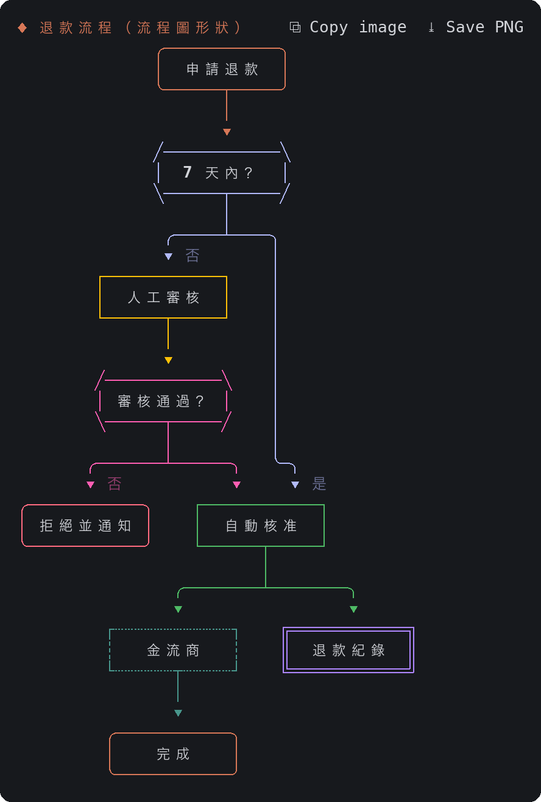 | 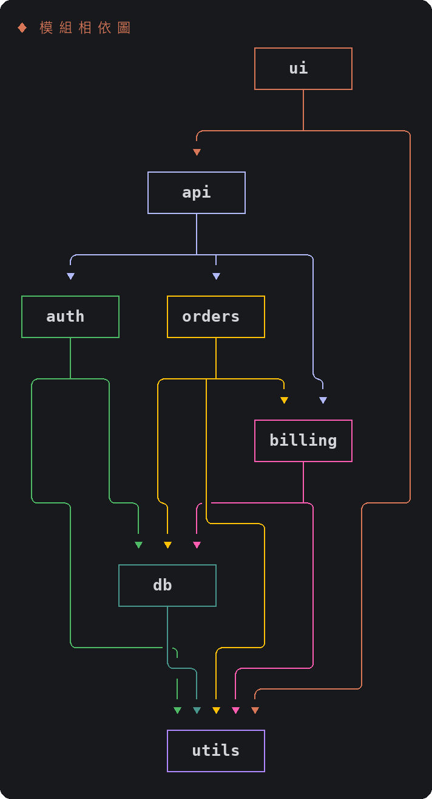 |

相依關係太密、線畫不清楚時，用 `layout: "matrix"` 改畫成矩陣，並附上統計：

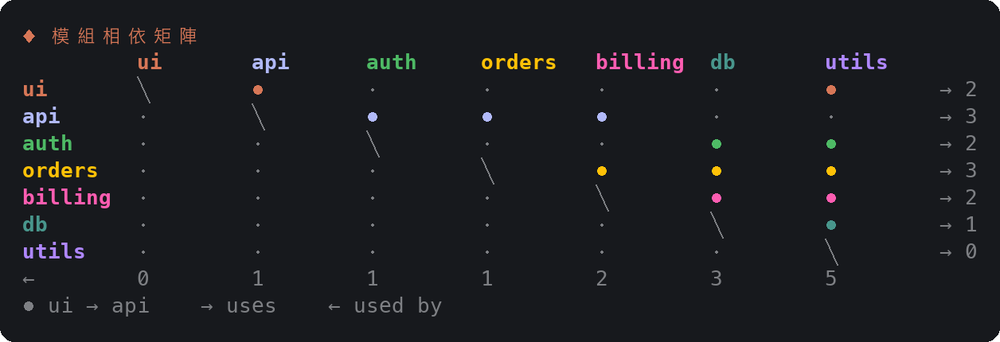

用 `layout: "zones"` 時，每個群組會變成一個有框線的區塊：子系統、網路邊界、C4 容器圖都能畫。`person` 形狀代表使用者或角色。


節點連回自己的線會畫成節點裡的迴圈，所以狀態機也是一種連線圖：


`layers` 的分區裡可以再放分區，可以用來畫部署拓撲（區域、可用區、子網）：


`schema` 畫出資料表或類別和它們的欄位，以及彼此的關係：

| 資料模型（ER） | 類別圖 |
| --- | --- |
|  |  |

`swimlane` 把流程的每一步放在負責者的泳道裡；`pipeline` 把階段由左到右排開；`gitgraph` 呈現分支隨時間的變化：

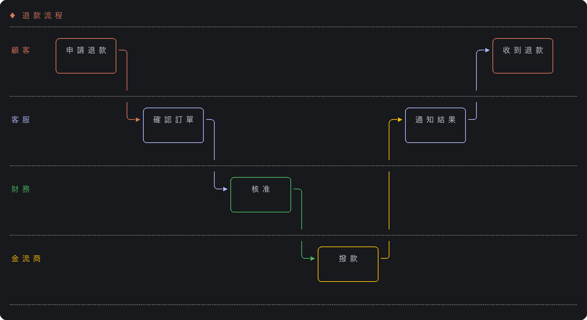


| 大綱 | 心智圖 |
| --- | --- |
|  | 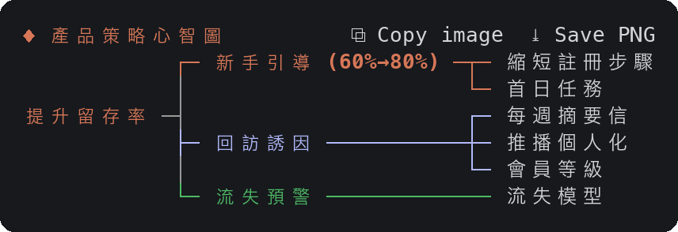 |

## 產品與規劃

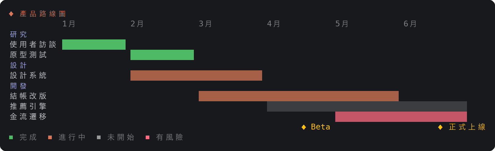


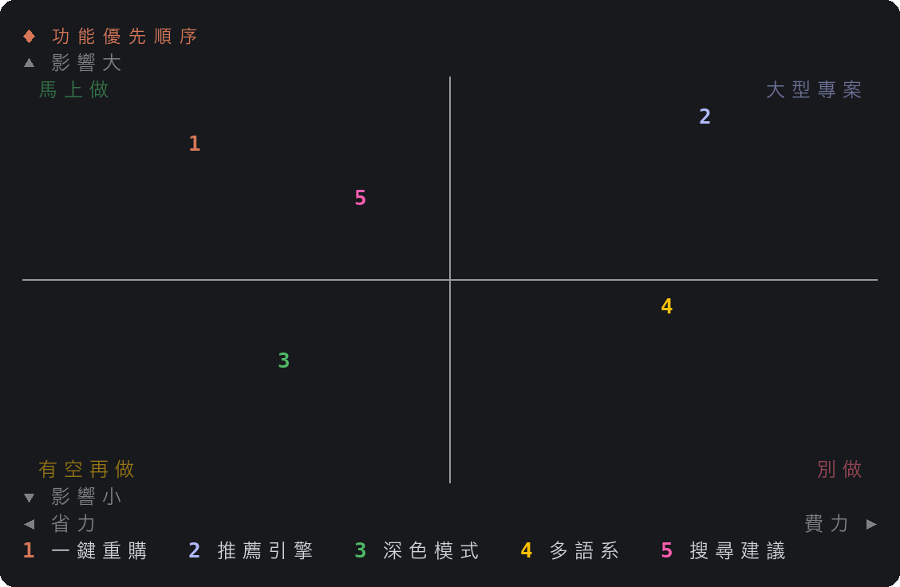


`compare` 畫出選項後，會在卡片下方開一個對話框，用方向鍵選擇；Claude 會照你選的繼續做。


## 設計與研究

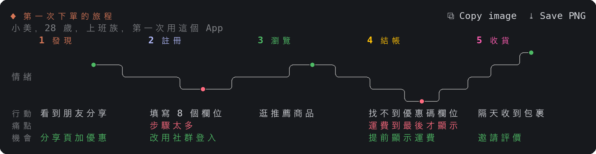


## 數字

圖表、指標方塊、時間軸和旅程圖，在 Claude 呼叫工具的過程中會逐步畫出來：

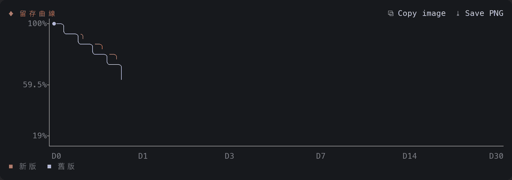

加上 `style: "image"`，折線圖、散佈圖、直條圖和直方圖的圖表本體會畫成真正的圖片：平滑的線、半透明的面積、圓角長條。這需要終端機支援顯示圖片（kitty、Ghostty、iTerm2），不支援時只會顯示一行替代文字。刻度和圖例仍以文字畫在旁邊，因為終端機裡的圖片沒有字型。上面那張存下來的圖就是這種圖表。

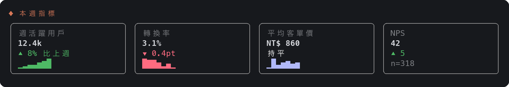


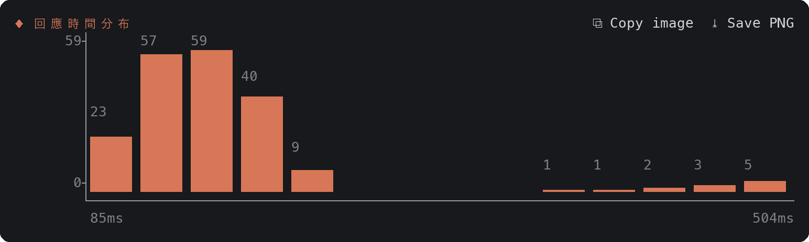


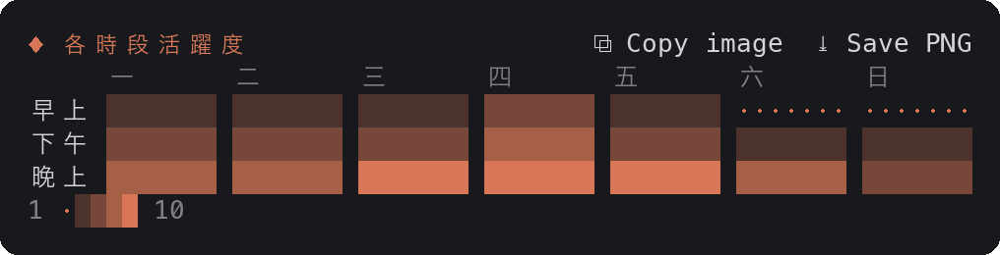


## 運作方式

整個 mod 只有一個 hooks 模組：[`hooks/register.tsx`](hooks/register.tsx)。

- session 開始時註冊 17 個工具。每個工具吃的都是單純的結構化輸入（節點與連線、時段與項目、標籤與數列）。
- 一個 `ui.render` hook 把每次工具呼叫在對話裡的那一列換成卡片，內容直接取自該次呼叫的輸入。滑鼠停留的高亮由介面直接處理，不用跑程式；節點名稱是按鈕。mod 唯一保存的狀態，是每張架構圖卡片聚焦哪個節點（宣告在 [`types/index.d.ts`](types/index.d.ts)），以及流動效果用的計時。
- 一個 `prompt.compose` hook 在系統提示裡加一小段，告訴 Claude 什麼情況用哪種卡片，並把卡片周圍的文字寫短。
- 圖表、指標、時間軸、旅程圖在呼叫進行時，會用大約一秒逐步畫出來。
- 按 `ctrl+o` 可以看到卡片背後原始的工具呼叫。
- Copy 和 Save 只會寫入 `~/Downloads/sketch/`，並執行上面提到的轉檔和剪貼簿指令；不會寫入或執行你電腦上的其他東西。

需要知道的事：

- 在載入這個 mod 的 session 裡，工具定義和那段提示會跟著每次請求送出，大約多 5 千個 token（這是估計值，不是量測值）。
- 卡片的寬度在繪製當下依終端機寬度決定。低於約 60 欄時，較寬的卡片會顯得擁擠。
- 全形字元（中文、日文、韓文）以兩格寬計算。如果你的終端機把 `●` 這類寬度不明確的符號畫成兩格寬，部分卡片會對不齊。
- 在 Claude Code 2.1.325 的終端機上開發與試用。卡片只用到每個介面都有的 `Box` 和 `Text`，但桌面版與手機版尚未測試。

## 關於這些圖片

這份說明裡的圖片不是視窗截圖，而是由 [`preview/`](preview) 裡的腳本產生的：`render.ts` 用一個替身引擎和它自己的簡易版面配置，執行 mod 真正的 hooks；`paint.py` 再用預設深色主題的顏色把結果畫成圖片。你終端機裡的版面來自 Claude Code 自己的引擎和你的主題，所以間距和顏色可能略有不同。動畫則由 `frames.ts` 用同一套 hooks 逐格產生；GIF 裡的「滑鼠停留」是照終端機的畫法呈現高亮效果，畫面上沒有游標。

重新產生圖片（macOS，需要 [Bun](https://bun.sh) 和裝有 Pillow 的 Python）：

```
cd preview
bun --jsx-factory=h --jsx-fragment=Fragment --jsx-runtime=classic render.ts ../hooks/register.tsx 110 cards.json ./samples.zh-TW.ts
python3 paint.py cards.json ../docs/images/zh-TW
bun --jsx-factory=h --jsx-fragment=Fragment --jsx-runtime=classic frames.ts ../hooks/register.tsx 110 ./samples.zh-TW.ts anim
SKETCH_GIF_SCALE=0.55 python3 paint.py anim-interaction.frames.json ../docs/images/zh-TW/interaction.gif
python3 paint.py anim-entrance.frames.json ../docs/images/zh-TW/entrance.gif
bun --jsx-factory=h --jsx-fragment=Fragment --jsx-runtime=classic exports.ts ../hooks/register.tsx ./samples.zh-TW.ts ../docs/images/zh-TW
```

英文版請改用 `samples.en.ts` 和 `docs/images/en`。

## 開發

```
claude --plugin-dir .        # 從這個資料夾載入 mod 開一個 session
claude plugin validate .     # 檢查 manifest 和 hooks 模組
```

用 `--plugin-dir` 開的 session 裡，修改 `hooks/register.tsx` 會自動重新載入。

## 授權

MIT
